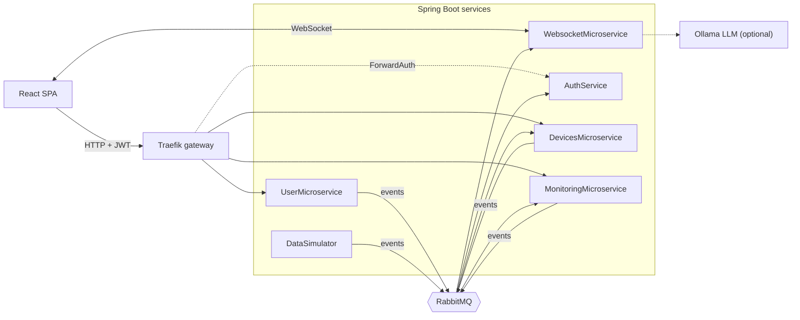

# Energy Management System

**Event-driven Spring Boot microservices for managing smart devices and monitoring their energy consumption in real time.**


Administrators manage users and devices. Users see their devices and hourly consumption charts, receive
**live alerts** when a device exceeds its limit, and can chat with an **AI support assistant** or an administrator.
The whole stack (6 Spring Boot services, a React SPA, Traefik, RabbitMQ and 4 PostgreSQL databases) starts with
a single `docker compose up`.

## Features

- **JWT authentication at the API gateway** (Traefik ForwardAuth) with role-based access (`ADMIN` / `USER`) and ownership checks in each service
- **Database per service**, kept consistent through **RabbitMQ domain events** (deleting a user or device cascades asynchronously)
- **Real-time overconsumption alerts** pushed to the browser over WebSocket (STOMP)
- **Support chat**: FAQ answers with fallback to a local LLM (Ollama), plus live user ↔ admin chat
- **Smart-meter simulator** that publishes readings for every device every 10 seconds

## Architecture



| Service | Responsibility |
|---|---|
| **AuthService** | Registration, login, BCrypt hashing, JWT issuing and validation for the gateway |
| **UserMicroservice** | User profiles (CRUD); publishes user events |
| **DevicesMicroservice** | Devices, limits and ownership; publishes device events |
| **MonitoringMicroservice** | Aggregates meter readings into hourly totals and detects overconsumption |
| **WebsocketMicroservice** | Pushes alerts to browsers; support chat with FAQ, Ollama and admin |
| **DataSimulator** | Simulates smart meters |

## Tech stack

| Layer | Technologies |
|---|---|
| Backend | Java 21, Spring Boot (Web, Data JPA, Security, AMQP, WebSocket, WebFlux), JJWT, Lombok |
| Messaging & data | RabbitMQ, PostgreSQL 15, Hibernate |
| Frontend | React 18, TypeScript, Chart.js, STOMP.js |
| Infrastructure | Docker Compose, Traefik v3, Nginx |

## Getting started

Requires [Docker](https://www.docker.com/products/docker-desktop/). [Ollama](https://ollama.com/) is optional (`ollama pull qwen3:8b`).

```bash
git clone https://github.com/<your-username>/energy-management-system.git
cd energy-management-system
cp .env.example .env        # optional: every variable has a development default
docker compose up --build -d
```

Open **http://localhost**. The RabbitMQ UI is at http://localhost:15672.

New accounts get the `USER` role. To create an administrator, register an account, promote it, then log in again:

```bash
docker exec -it postgres-auth psql -U postgres -d Credentials \
  -c "UPDATE credentials SET role = 'ADMIN' WHERE email = 'admin@example.com';"
```

**Try it:** as admin, create a device with a low limit (e.g. `20` kWh) and assign it to a user. Log in as that user
to see the consumption chart fill up and an overconsumption alert appear within a few minutes.

## Design notes

- **Authentication at the edge**: the JWT is validated once, at the gateway, which forwards the identity as headers. Services stay stateless and authorize with a custom `@RequireRole` annotation and a Spring MVC interceptor.
- **Eventual consistency**: services never share tables; they exchange domain events over fanout exchanges instead of using distributed transactions.
- **Idempotent alerting**: at most one alert per device per hour.
- **Graceful degradation**: the chatbot tries the FAQ first and falls back to a static reply if the LLM is down. The simulator caches devices and retries failed calls.
